# Capturas — Gerenciador de Abertura de Habilitações, v2.0

Geradas em 21/10/2026 pela suíte [`testar_navegador.js`](../../../../../sistemas/abertura-habilitacoes/gerenciador/testes/testar_navegador.js) (Playwright/Chromium), com `google.script.run` simulado. **Todos os dados são fictícios**: nomes inventados, e-mails do domínio reservado `.invalid`, Nº USP na faixa 9000xxx. Nenhuma planilha real foi lida e nenhum e-mail foi enviado. O pedido com nome `` é proposital: confere que dados da planilha aparecem como texto.

O teste roda sem rede: a marca USP externa do tema claro aparece como um retângulo azul. São capturas da fonte do repositório, **não** da versão implantada (a 2.0 não está implantada).

Para regenerar, na pasta `testes/`: `EVIDENCIAS=../../../../docs/sistemas/abertura-habilitacoes/evidencias/2.0 node testar_navegador.js`. A suíte grava mais capturas do que as guardadas aqui (temas escuros de todas as telas e outras larguras); só esta seleção foi versionada.

### Pendentes, menu lateral, tema claro

Dois pedidos sem identificador utilizável continuam na lista, marcados e sem ação (o de cima pode ser preparado por quem administra).

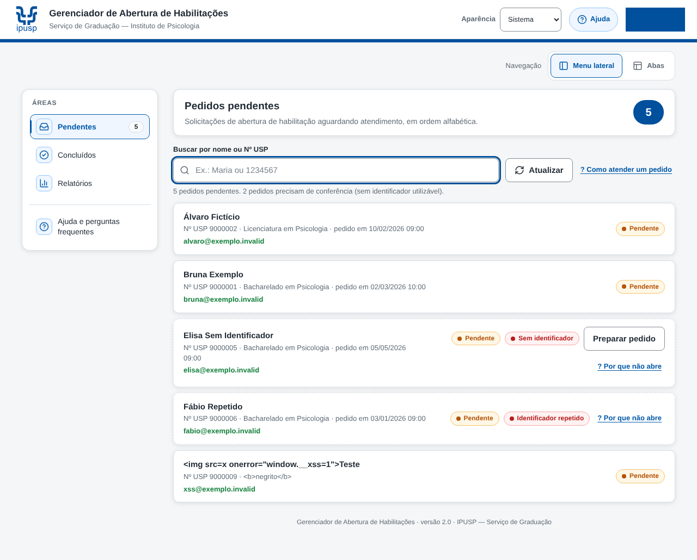

### Pendentes, tema escuro

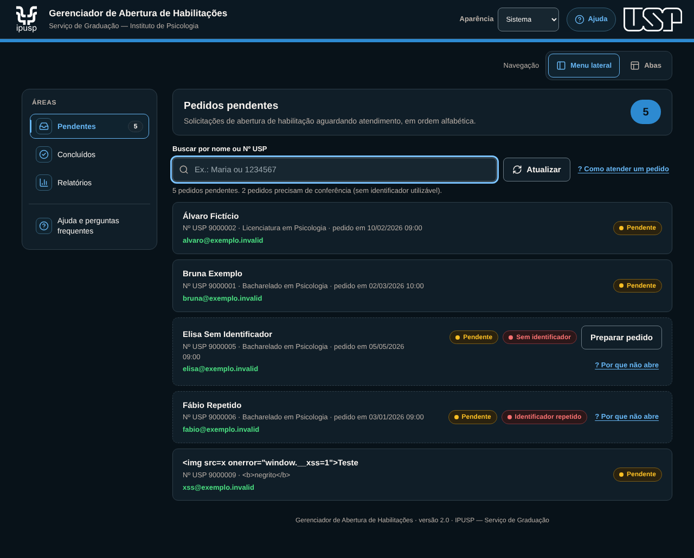

### Detalhe de um pedido pendente

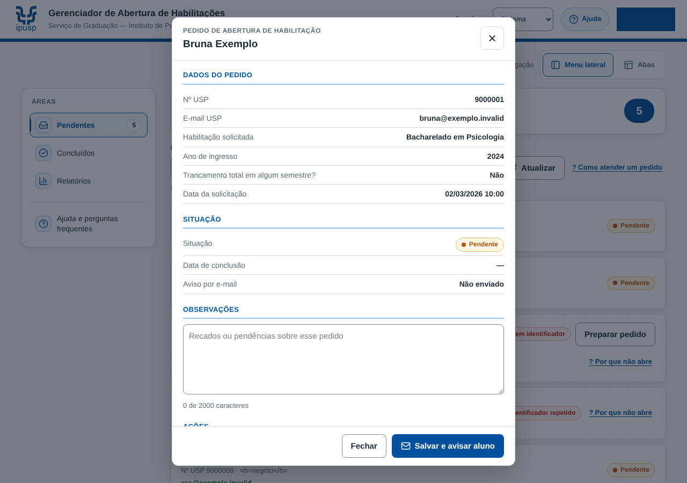

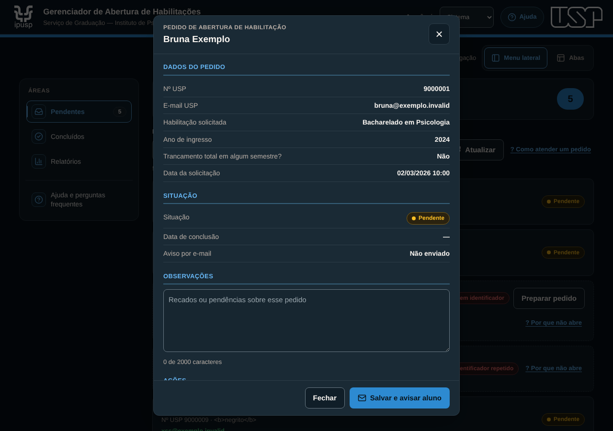

### Confirmação antes do e-mail

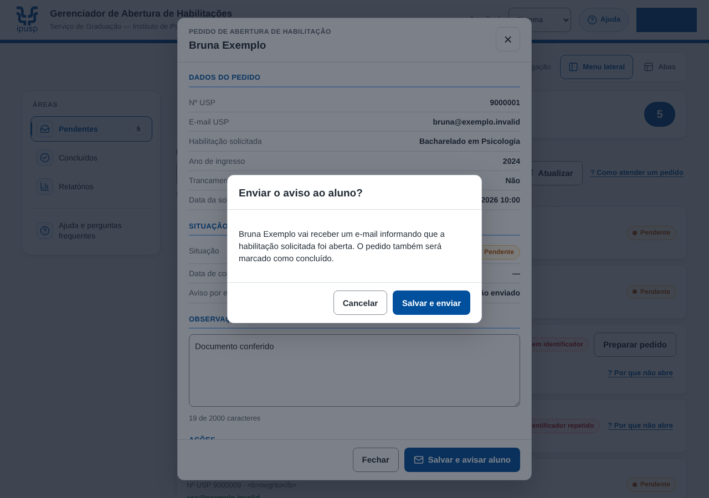

### Pedido salvo, e-mail não enviado

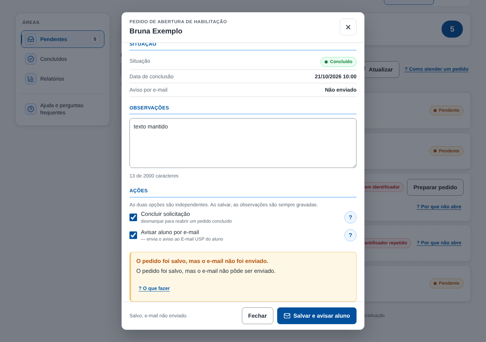

### Pedido alterado em outra sessão

O texto digitado continua na tela; "Recarregar pedido" mostra as observações atuais.

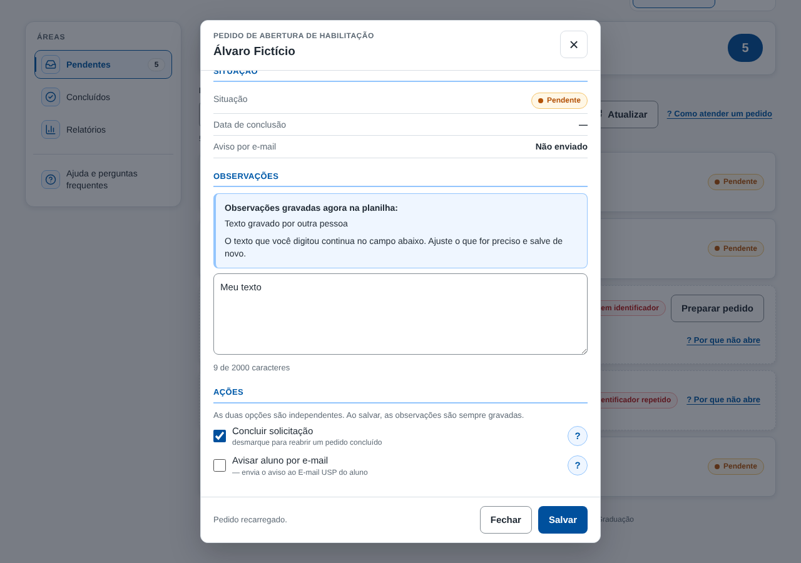

### Concluídos e busca no histórico (inclui 2021–2022, só consulta)

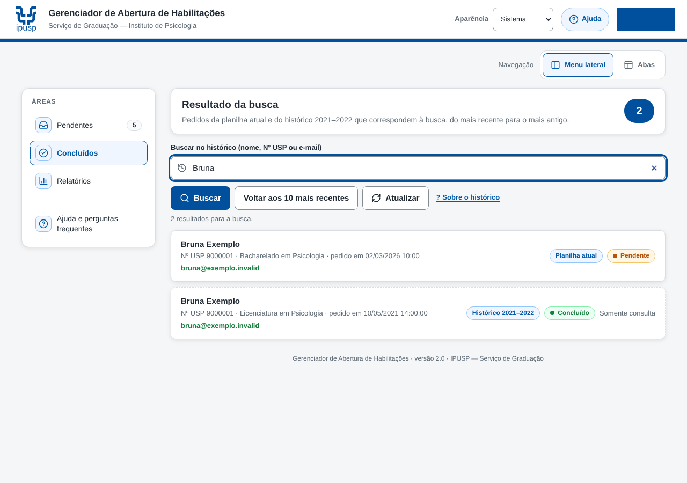

### Relatórios

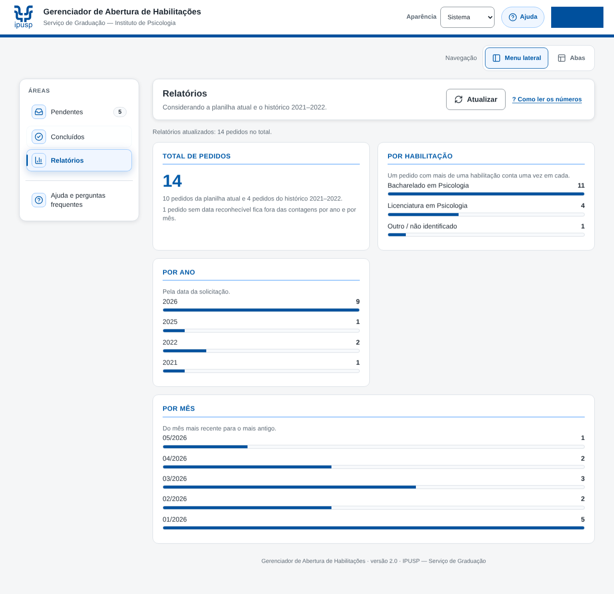

### Navegação por abas

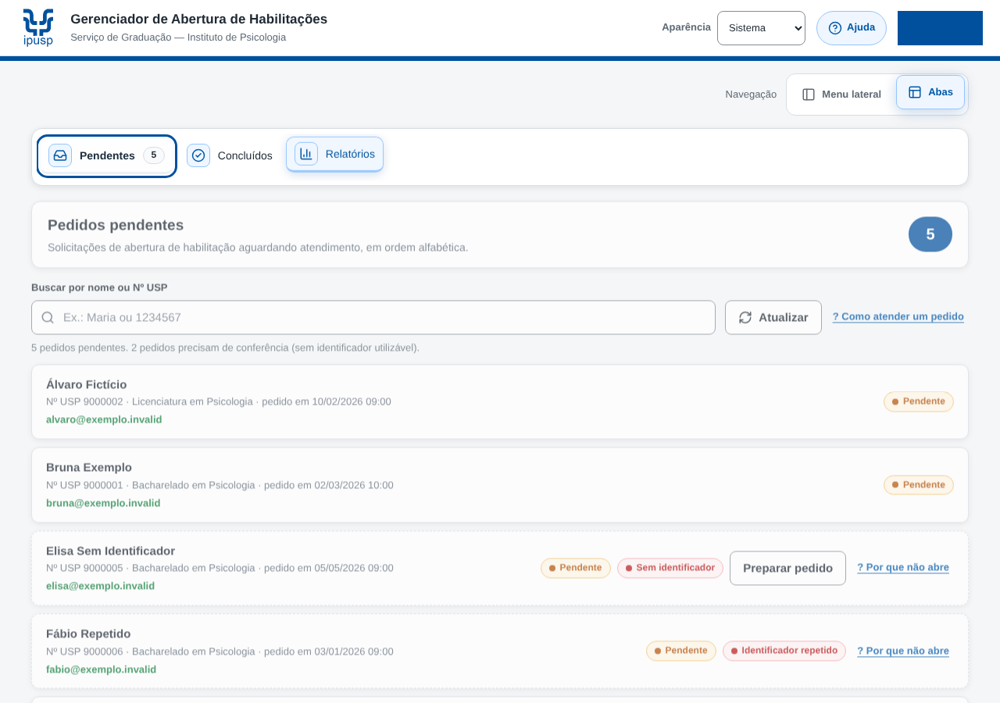

### Central de Ajuda

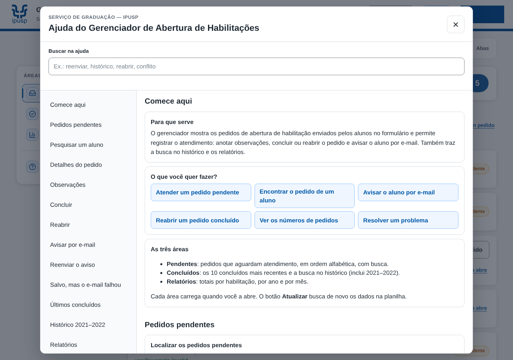

### Perfil LEITOR (sem ações de gravação)

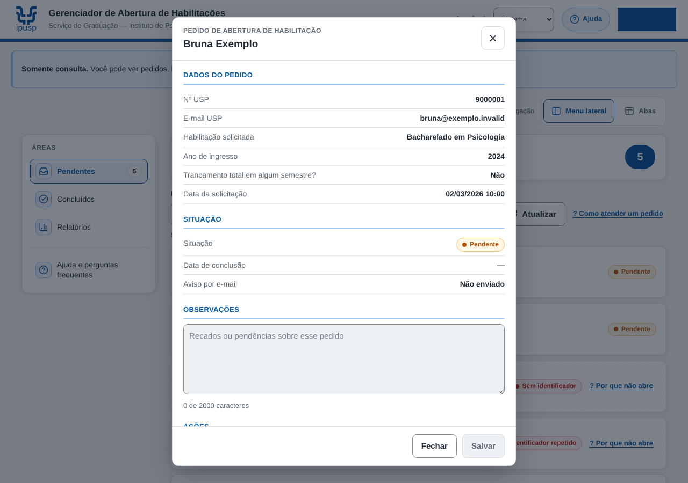

### Larguras

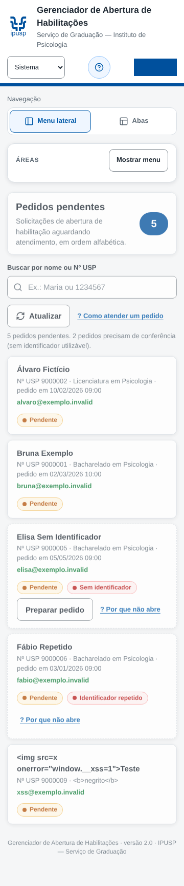

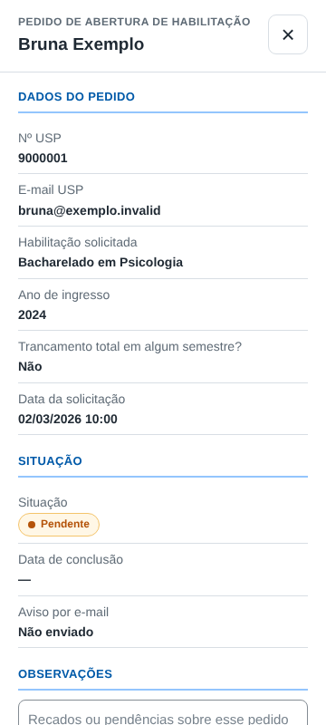

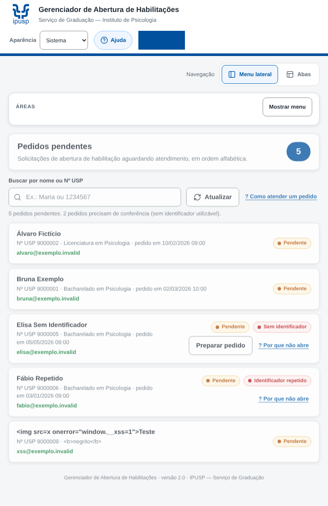

### Conta sem acesso (nenhum dado é enviado)

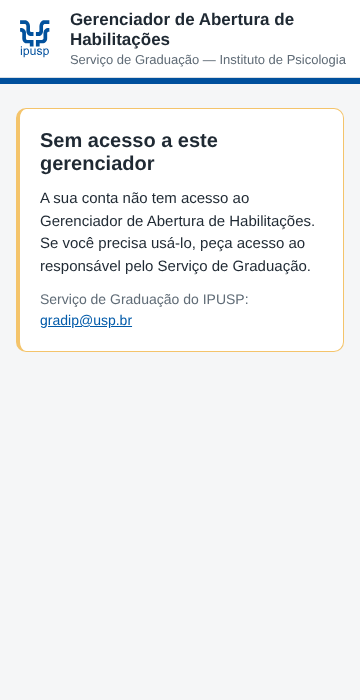
