# Capturas — Pedido de Abertura de Habilitação (formulário dos alunos), v2.0

Geradas em 05/11/2026 pela suíte [`testar_navegador.js`](../../../../../sistemas/abertura-habilitacoes/formulario/testes/testar_navegador.js) (Playwright/Chromium), com os serviços Google simulados. **Todos os dados são fictícios** ("Aluna Teste Ficticia", `ana@usp.br`, Nº USP `9900001`). Nenhuma planilha real foi lida. Sem rede, a marca USP do tema claro vem de `assets/usp/logo-usp-preto.svg`.

Para regenerar, na pasta de testes: `node testar_navegador.js <pasta-de-saída>`.

### Formulário, tema claro, 768 px

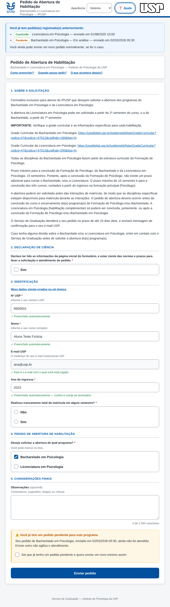

### Formulário, tema escuro, 768 px

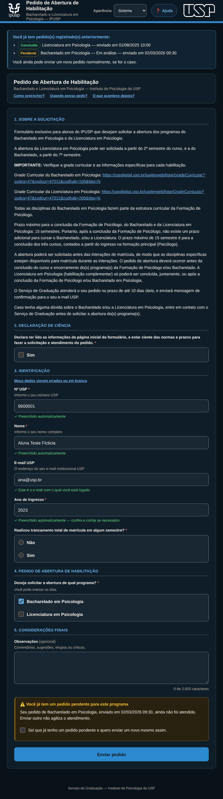

### Celular, tema claro, 360 px

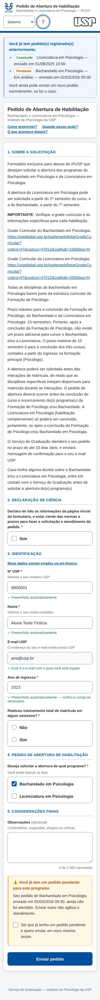

### Celular, tema escuro, 360 px

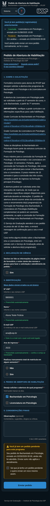

### Validação com erros, claro

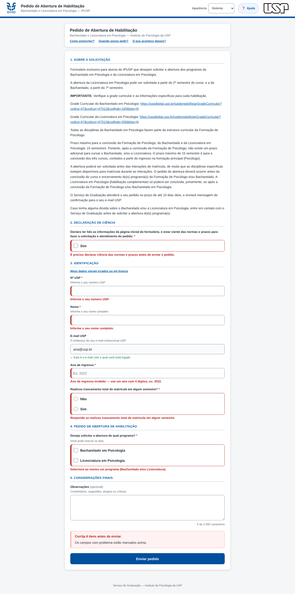

### Validação com erros, escuro

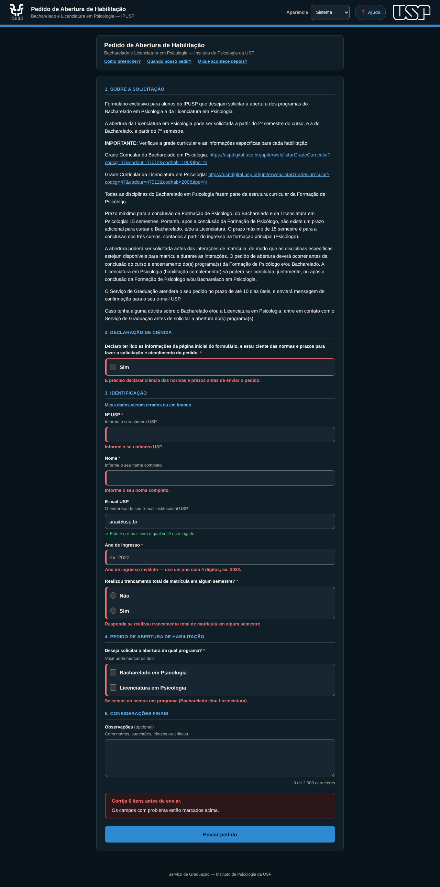

### Pedido pendente para o mesmo programa, claro

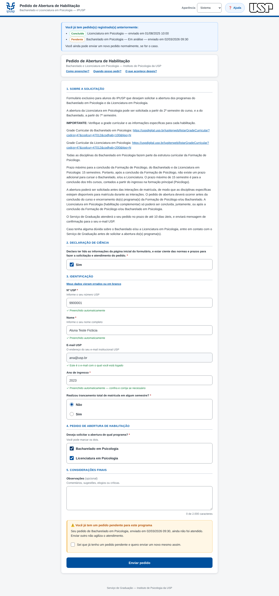

### Pedido pendente para o mesmo programa, escuro

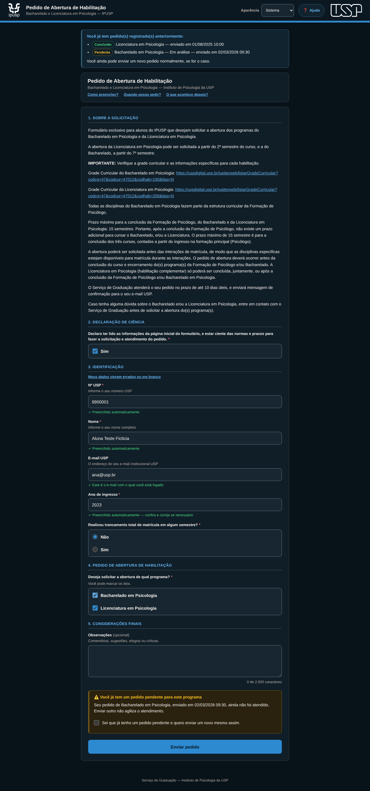

### Pedido enviado, claro

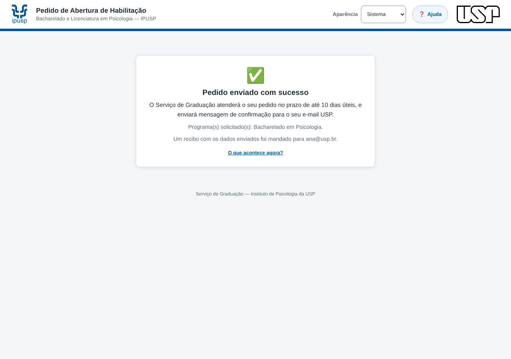

### Pedido enviado, escuro

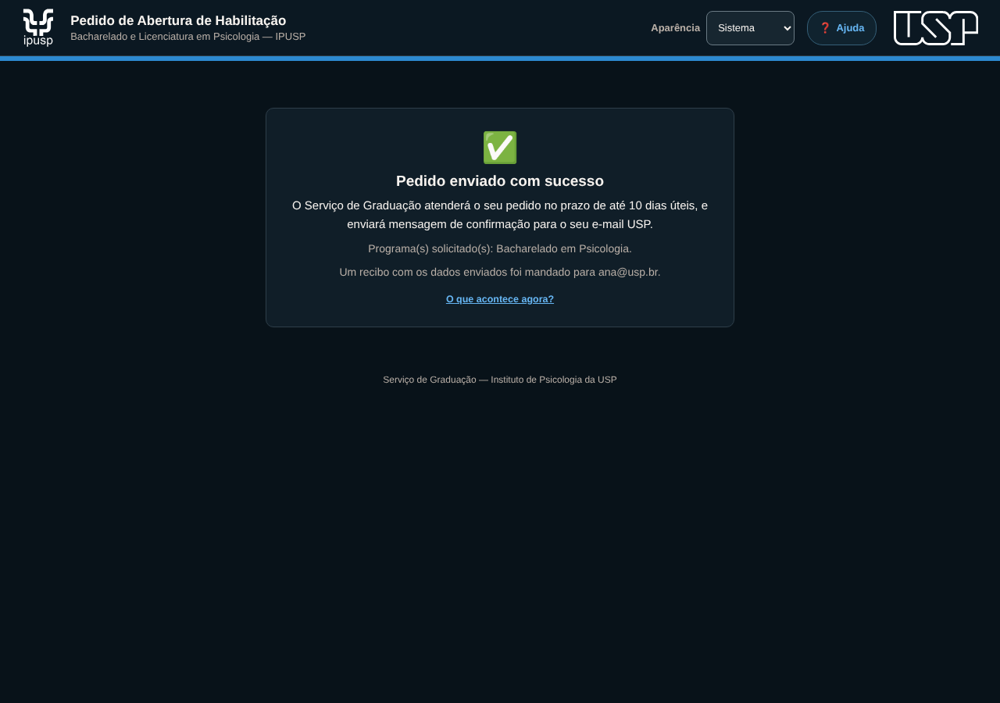

### Fora do período, claro

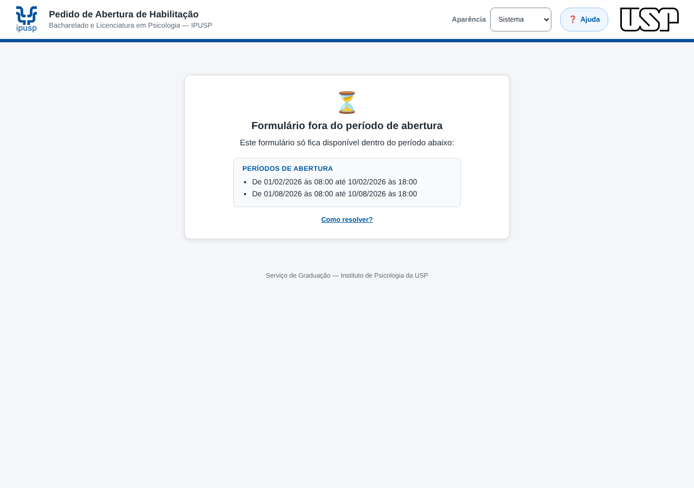

### Fora do período, escuro

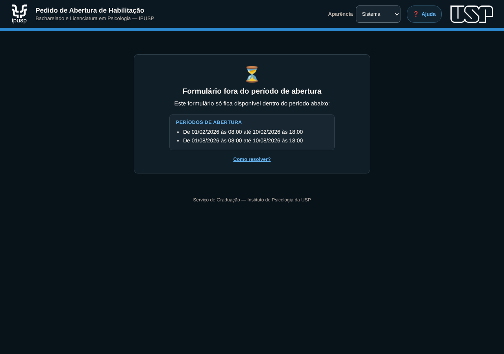

### Central de Ajuda, claro

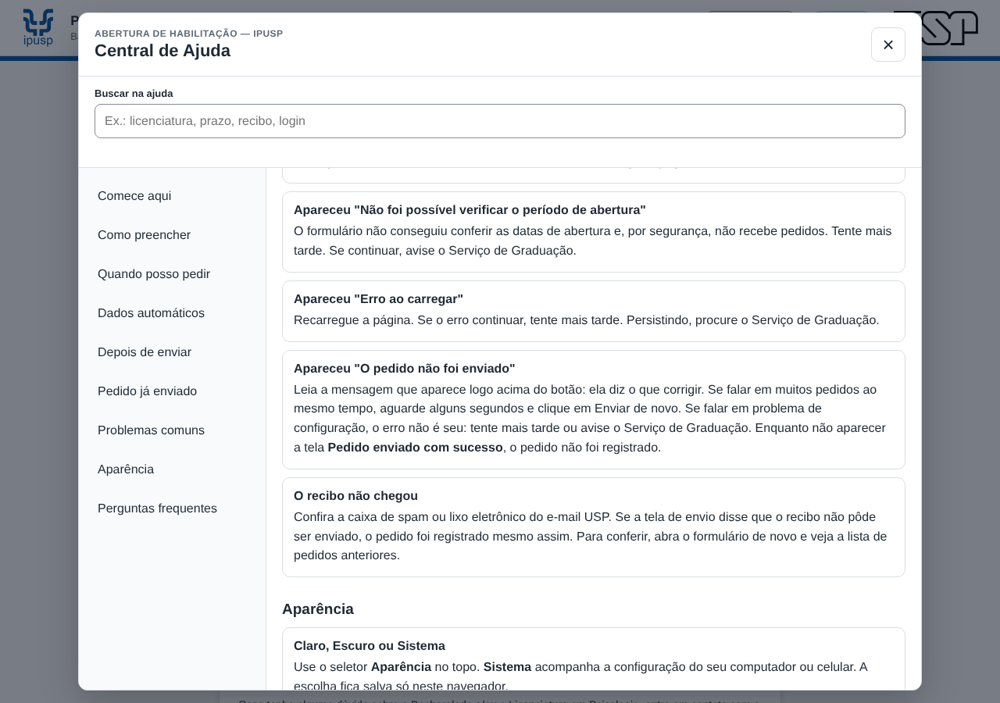

### Central de Ajuda, escuro

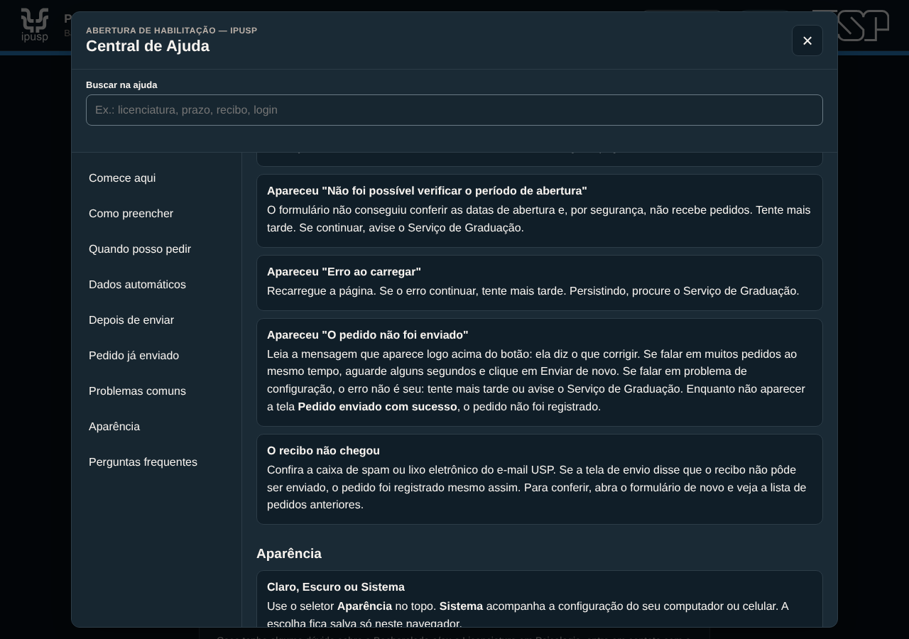

### Central de Ajuda no celular, claro

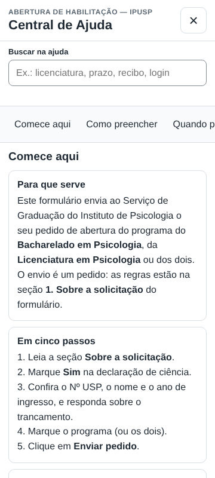

### Central de Ajuda no celular, escuro

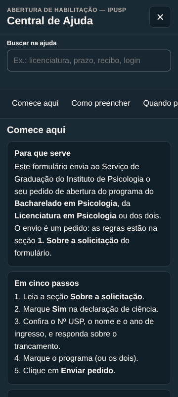

### Faixa de homologação, claro

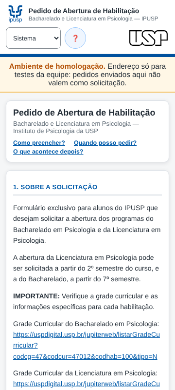

### Faixa de homologação, escuro

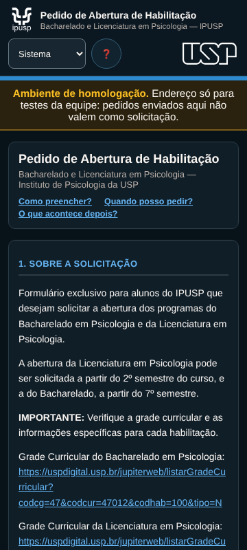
