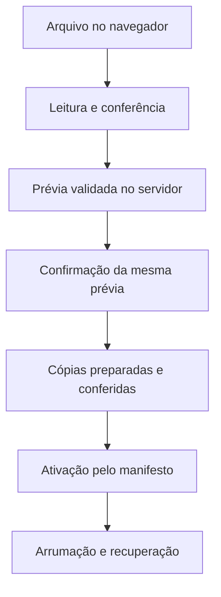

# Contratos e fluxos — 1.10.0

Os contratos de negócio vêm da baseline 1.9.3 e foram preservados. Entradas/saídas detalhadas estão em [ARQUITETURA.md](ARQUITETURA.md), seção 3; pacote de importação em `LeitorComum.html`; validação efetiva em `Importacao.gs`. Esta página é o mapa de chamadas e estados para manutenção.

## Fronteiras e operações

O cliente usa `google.script.run` e interpreta `{ok:true,dados}` ou `{ok:false,codigo,erro,…}`. Falha de transporte é diferente de resposta negativa de negócio. O servidor valida papel, pacote e estado persistido; ocultar controles não é autorização.

Auxiliares de servidor terminam em `_`; acionadores públicos validam eventos reais. `doGet()` produz a página sem base embutida; `obterDadosPainel()` carrega depois. PDF/OCR só carrega dependências quando um PDF é escolhido.

| Operação pública | Perfil | Contrato e efeito principal |
|---|---|---|
| `obterDadosPainel()` | admin/leitor | usuário, versão, base, preparação e histórico; admin pode preparar/recuperar antes de ler; leitor não executa essas escritas |
| `prepararImportacao(pacote)` | admin | prévia/bloqueios, assinatura, operação e impressão; pode preparar/recuperar base; revisão paginada em cache |
| `obterPaginaRevisao(operacao,pagina)` | admin que gerou a prévia | entrega/registro de página; expiração exige nova conferência |
| `confirmarImportacao(pacote,assinatura,opcoes)` | admin | revalida a mesma prévia; opções conservam operação/revisão/impressão; prepara, ativa e arruma |
| `verificarImportacao(operacao)` | admin | manifesto: `gravada`/`nao_gravada`; não verifica envio da grade |
| `salvarDisciplina(dados)` | admin | origem/chave/campos/oferta/observações e inclusão/restauração; discrimina salvamento e adição à grade |
| `resolverSalvamentoPendente(pedido)` | admin | concluir/descartar nas condições permitidas; não desfaz escritas confirmadas |
| `excluirDisciplinas(itens,excluir)` | admin | exclusão/restauração de lote validado |
| `adicionarAGrade(itens)` / `removerDaGrade(itens)` | admin | seleção efetiva de itens `{origem,chave}` |
| `resolverLotePendente(pedido)` | admin | retoma/conclui ou descarta lote permitido |
| `cadastrarNovaGrade(confirmacao)` | admin | `APAGAR`; reinício com marca de retomada, sem backup automático da base |
| `cadastrarDisciplinaOutros(dados)` | admin | cadastro de identidade própria em Outros |
| `previaDisciplinasUnidade(texto,arquivo)` | admin | leitura/validação e assinatura do CSV |
| `incluirDisciplinasUnidade(texto,arquivo,assinatura,codigos)` | admin | refaz prévia e inclui os códigos explicitamente escolhidos |
| `previaEnvioGrade({semestre,ano})` | admin | linhas das seis abas, contagens e assinatura; a preparação pode concluir pendência anterior |
| `enviarGradeParaPreenchimento(pedido)` | admin | exige assinatura, recalcula sob trava, backup/índice antes de apagar; escrita/fórmula/renomeação/auditoria |
| `obterAuditoriaGrade(pedido)` | admin/leitor | semestres, registros/agregações e situação da grade atual; sem ID/link cru de auditoria |
| `diagnosticarConfiguracao()` / `diagnosticarEnvioGrade()` | admin/editor | diagnóstico sem exibir valores de IDs em log |
| `ativarAuditoriaGrade()` / `desativarAuditoriaGrade()` | admin/editor | instalar/remover acionadores; ativação sob trava, cria/reusa auditoria |
| `registrarEdicaoGrade(e)` / `registrarAberturaGrade(e)` | acionador validado | registros na auditoria sob identidade do instalador |

## Importação e ativação

Sheets não oferece transação multiaba: manifesto é o ponto de ativação. A leitura consistente consulta manifesto → abas por ID → manifesto de novo. Histórico/contagens isolados não substituem essa confirmação.

Falhas antes/depois de ativar e de resultado incerto têm tratamentos próprios. Preserve `operacao` para verificar uma confirmação sem resposta e impedir duplicidade. Revisão PDF se vincula a usuário, prévia, impressão e páginas entregues; confirmação genérica no cliente não basta.

## Salvamento e lote

Salvar a estrutura pode escrever Ajustes e Observações em abas diferentes. Pedido é registrado, aplicado, conferido e concluído; interrupção pode deixar parte persistida. Lotes usam cabeçalho/partes nas Script Properties, com conferência por item. Concluir uma pendência não prova que a recarga do cliente leu o resultado: `leituraFalhou` exige orientação de recarga.

Não limpe manualmente `estruturaCurricular.salvamento`, `estruturaCurricular.lote*` ou diários para esconder alertas. Descarte não é rollback. Um pedido posterior pode concluir a pendência anterior e recusar a operação nova para exigir revisão.

## Conteúdo conferido no envio

Prévia/envio usam a mesma montagem C/D/E e I/J, ordem dos grupos, semestre e ano. Formato canônico `grade-horaria-envio/1`, hash SHA-256. Nome inclui observações conforme a montagem existente. Zero e vazio são distintos.

`pedido.assinatura` é obrigatório. `pedido.esperado` pode acrescentar contagens, nunca substituir assinatura. Ausência/má formação → `PREVIA_INVALIDA`; conteúdo diferente → `PREVIA_DESATUALIZADA`, antes do backup/apagamento. CH e disciplinas fora do conteúdo enviado não invalidam a confirmação.

Prévia, cópia criada, cópia indexada, dados escritos, fórmulas concluídas, arquivo renomeado e auditoria integrada são etapas distintas. `ENVIO_INCOMPLETO` pode ocorrer mesmo depois dos dados e fórmulas. Não inferir sucesso no cliente só de contagens ou das seis abas.

## Contrato novo de apresentação

`window.EstruturaNavegacao.getModo()` retorna `sidebar`/`abas`; `setModo(modo)` muda somente layout. Não chama negócio nem armazenamento. Interação normal usa o controle visível; API serve à manutenção/verificação.

Move `#visoes`, `#etapas`, `#abasEstrutura`. IDs, nós, listeners, seleção, contagens e controles de painel são existentes. Observa `hidden` para reproduzir a visibilidade dos ancestrais originais. ↑/↓ encaminham à rotina de ←/→ dos controladores. Prévia mantém abas locais e recebe ícones após renderização.

Nova etapa/consulta exige revisar HTML, controlador, mapa de donos, ícone e docs juntos; entrada visual não pode contornar validação de servidor.
