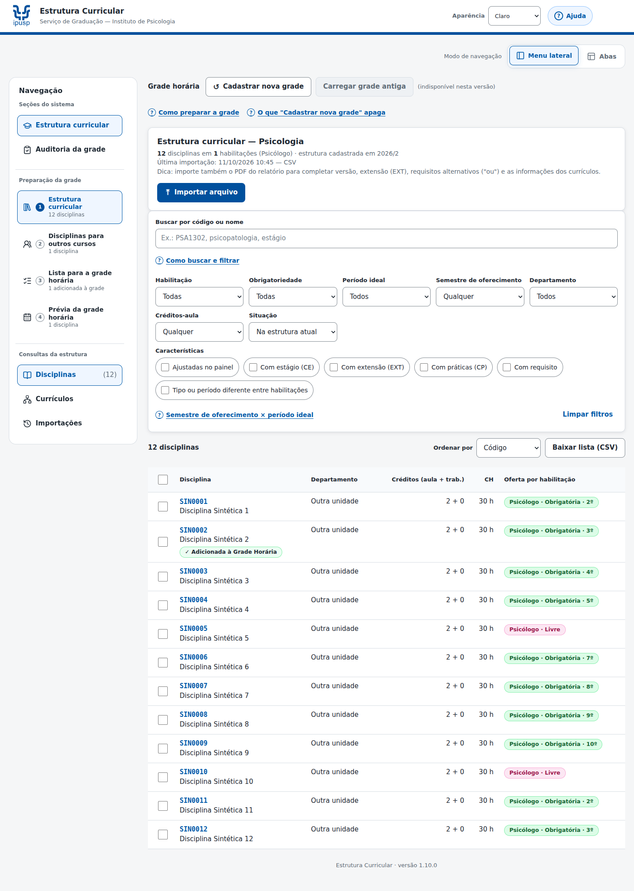
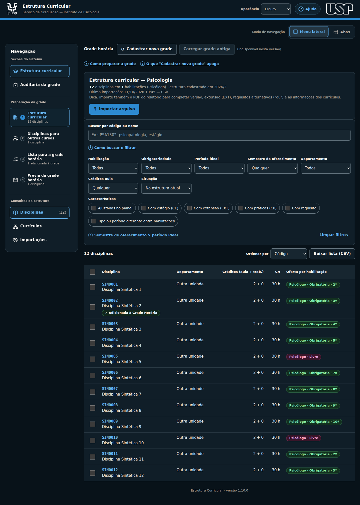
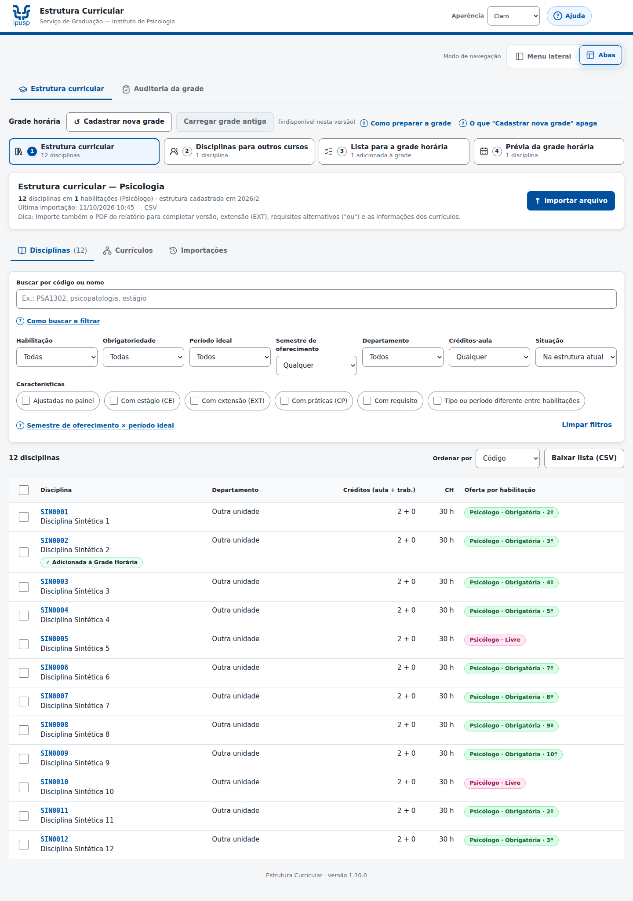
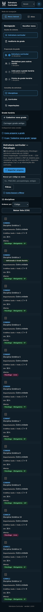

# Evidências locais — 1.10.0

Rodada de 11/10/2026, somente dados sintéticos e serviços Google simulados. **169/169** verificações em oito suítes. [Relatório e limites](../../VERIFICACAO_1_10_0.md).

| Registro | Conteúdo |
|---|---|
| [resultados.json](resultados.json) | contagens, ambiente e resultados por suíte |
| [comparacao_baseline.json](comparacao_baseline.json) | SHA-256 da fonte atual/baseline, preservação de negócio e Validacoes |
| [contraste.json](contraste.json) | 50 medições dos controles da navegação |
| [navegacao-visual.txt](navegacao-visual.txt) | suíte nova de layout/estado/acessibilidade |
| [central-ajuda.txt](central-ajuda.txt) | 50 cenários da Central de Ajuda |
| [previa-envio.txt](previa-envio.txt) | conferência do conteúdo de envio |
| [auditoria-envio.txt](auditoria-envio.txt) | resultado sem link cru de auditoria |
| [trava-auditoria.txt](trava-auditoria.txt) | exclusão mútua e acionadores |
| [navegador-envio.txt](navegador-envio.txt) | interface de confirmação/envio |
| [navegador-auditoria.txt](navegador-auditoria.txt) | interface de resultado/auditoria |
| [navegador-oferta.txt](navegador-oferta.txt) | ficha, oferta e restauração |

Capturas de exemplo, com disciplinas fictícias:

