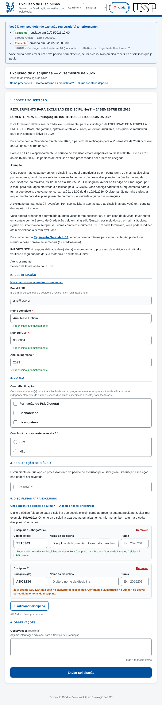
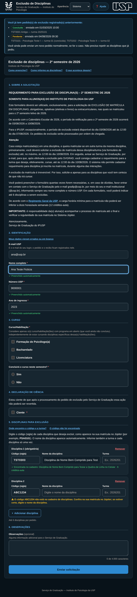
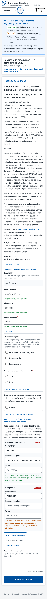
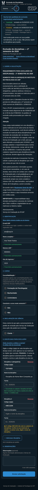
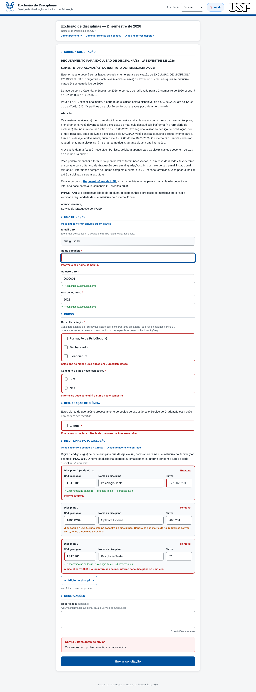
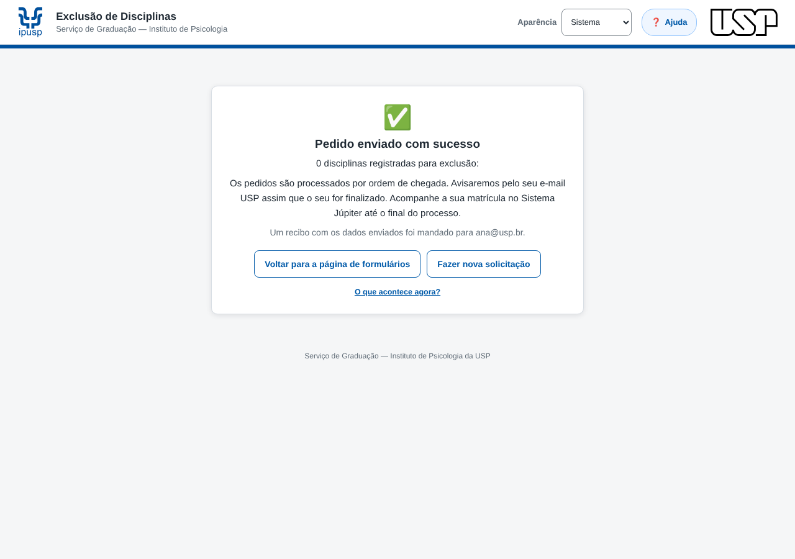
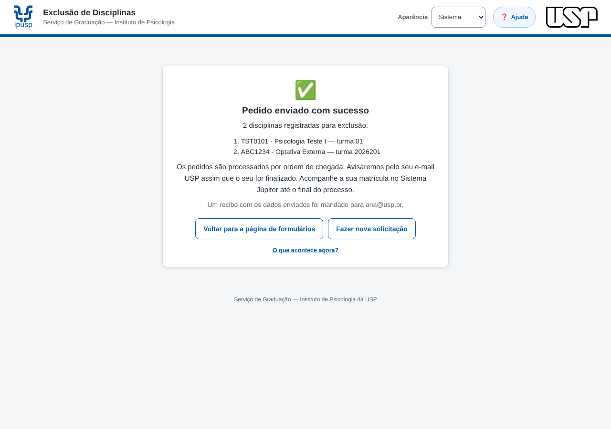
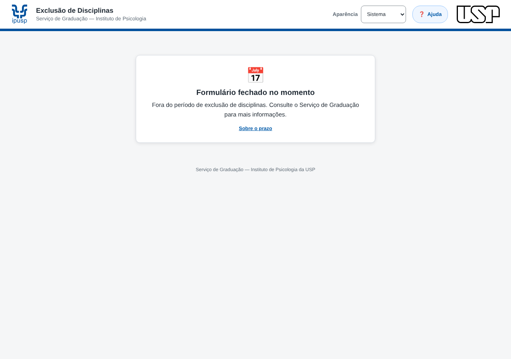
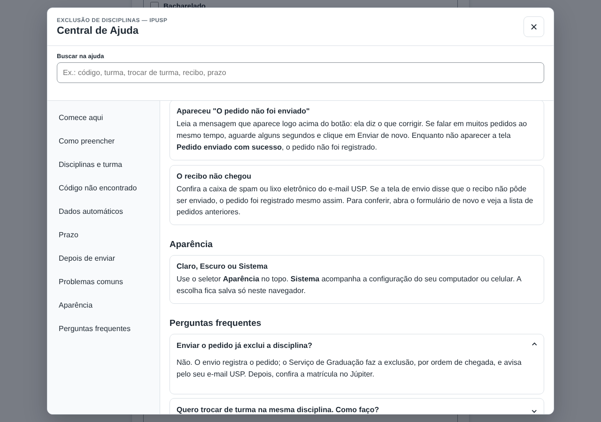
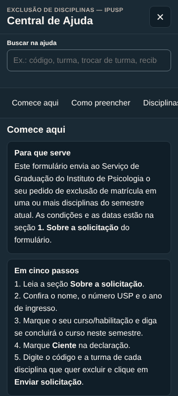

# Capturas — Exclusão de Disciplinas (formulário dos alunos), v1.1

Geradas em 16/10/2026 pela suíte [`testar_navegador.js`](../../../../../sistemas/exclusao-disciplinas/formulario/testes/testar_navegador.js) (Playwright/Chromium), com serviços Google simulados. **Todos os dados são fictícios**: aluno "Ana Teste Ficticia", e-mail `ana@usp.br`, nº USP `9000001`, disciplinas com prefixo `TST`. Nenhuma planilha real foi lida.

O teste roda sem rede: a marca USP do tema claro é servida pelo SVG do repositório (`assets/usp/logo-usp-preto.svg`) no lugar do PNG institucional. Datas de período são as do cenário de teste, não do calendário real.

Para regenerar, na pasta de testes: `node testar_navegador.js <pasta-de-saída>` (o argumento ativa as capturas).

### Formulário, tema claro, 768 px

### Formulário, tema escuro, 768 px

### Celular, tema claro, 360 px

### Celular, tema escuro, 360 px

### Validação com erros, tema claro

### Pedidos anteriores no topo, tema claro

### Confirmação depois do envio, tema claro

### Formulário fora do período, tema claro

### Central de Ajuda, tema claro

### Central de Ajuda no celular, tema escuro, 360 px

