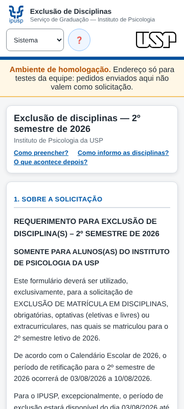
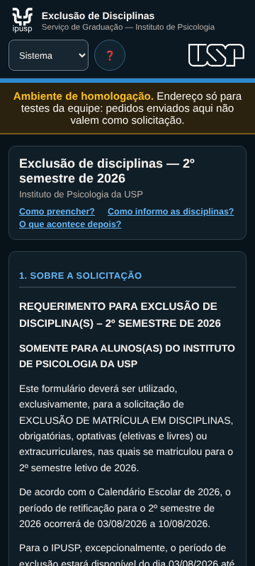

# Capturas — v1.2

A v1.2 só acrescenta o [ambiente de homologação](../../../AMBIENTE_DE_HOMOLOGACAO.md). As demais telas não mudaram e estão em [evidencias/1.1](../1.1/README.md).

Geradas em 16/10/2026 pela suíte de navegador, com dados fictícios e a página montada com `AMBIENTE` = `homologacao`. Em produção a faixa não aparece.

### Faixa de homologação, tema claro, 360 px

### Faixa de homologação, tema escuro, 360 px

