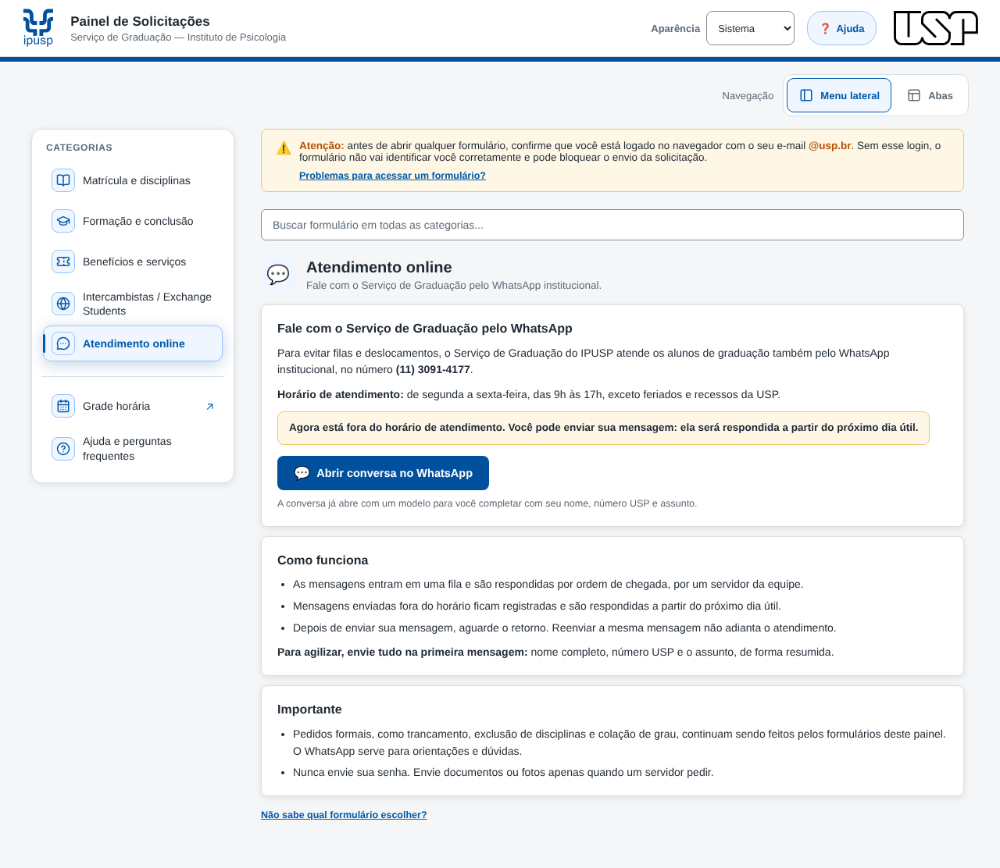
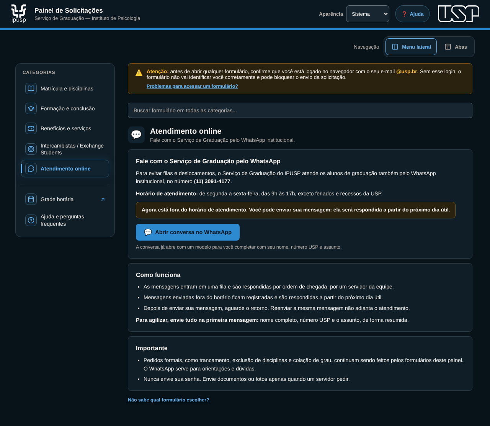
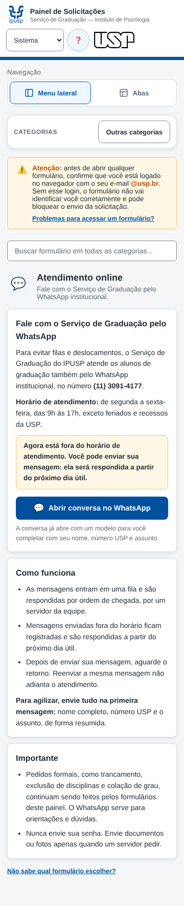
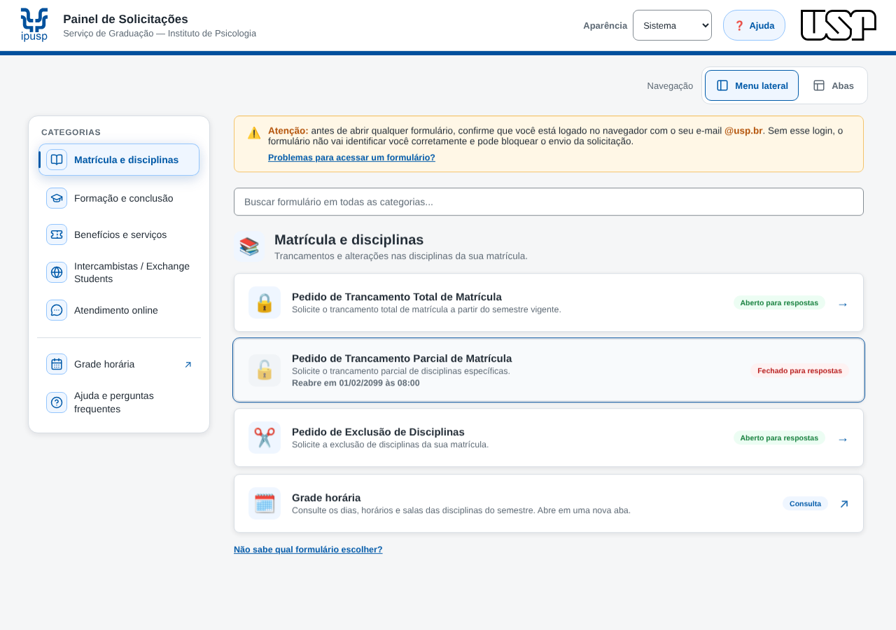
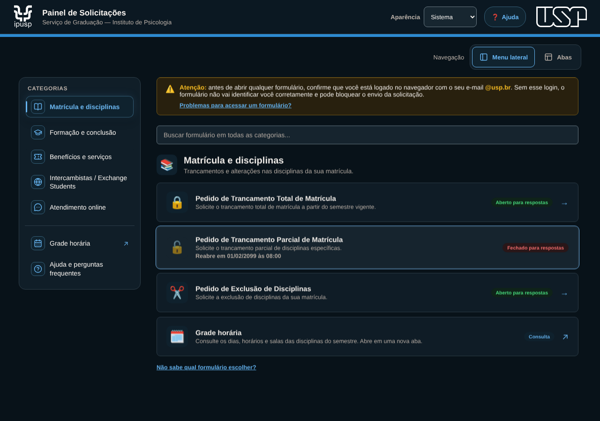
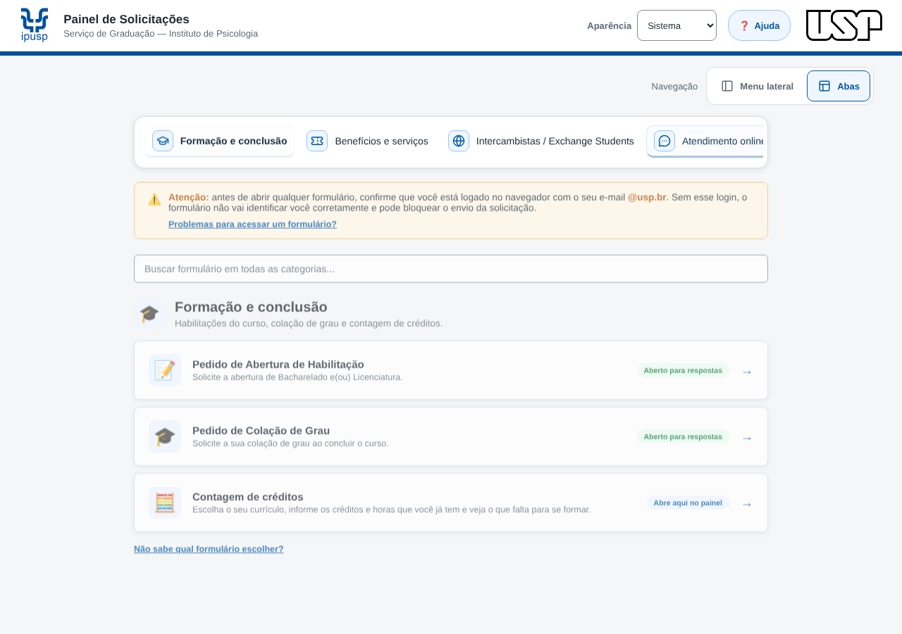
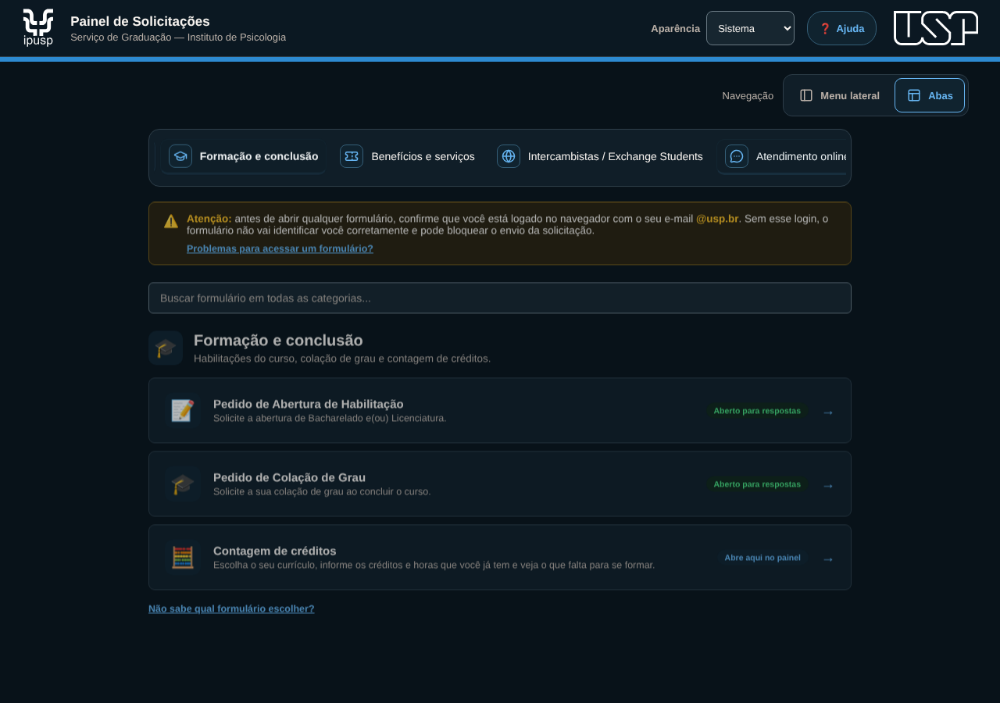
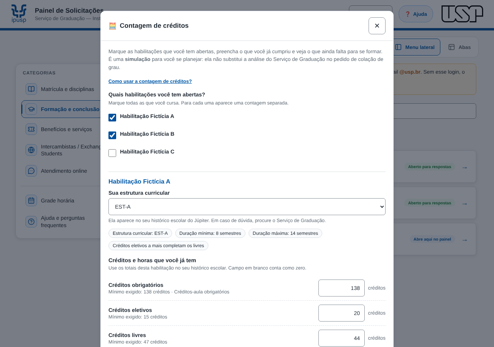
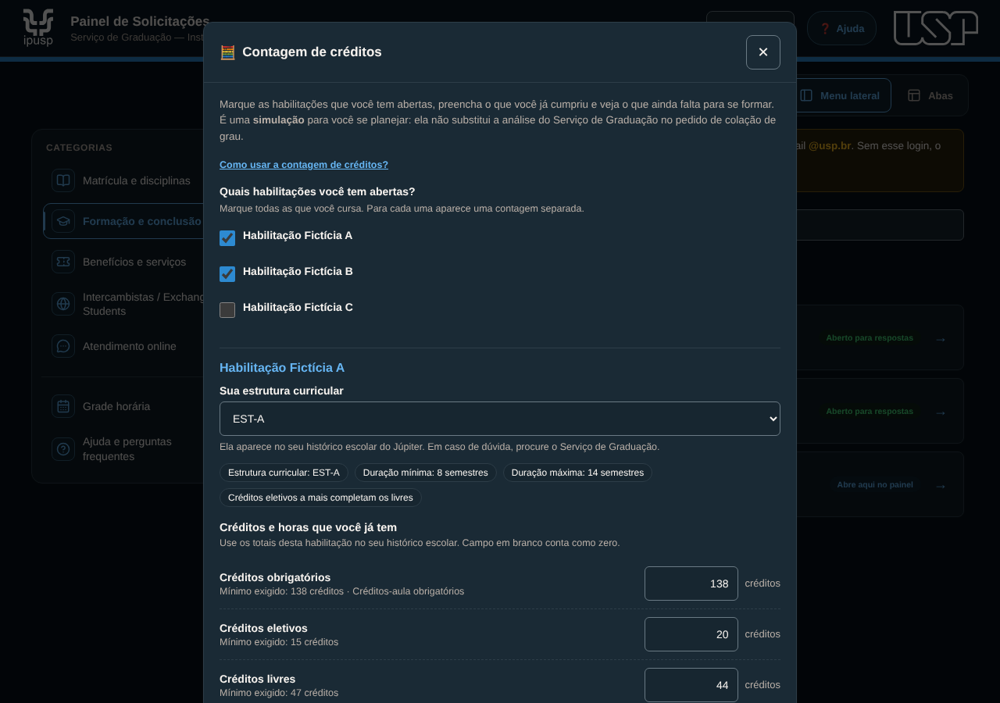
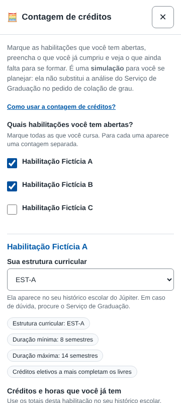

# Capturas — Painel de Solicitações (alunos), v1.5

Geradas em 20/10/2026 pela suíte [`testar_navegador.js`](../../../../../sistemas/painel-solicitacoes/testes/testar_navegador.js) (Playwright/Chromium), com `google.script.run` simulado. **Todos os dados são fictícios**: períodos, habilitações e currículos do cenário de teste (curso `99999`, disciplinas `TST*`). Nenhuma planilha real foi lida. O número de WhatsApp mostrado é o canal público do Serviço de Graduação.

O teste roda sem rede: a marca USP do tema claro é servida pelo SVG do repositório (`assets/usp/logo-usp-preto.svg`) no lugar do PNG institucional. Nas capturas do Atendimento online o aviso de horário foi fixado em "fora do horário", para não depender da hora em que o teste rodou.

Para regenerar, na pasta de testes: `node testar_navegador.js <pasta-de-saída>`.

### Atendimento online, tema claro

### Atendimento online, tema escuro

### Atendimento online no celular, 360 px

### Menu lateral, tema claro

### Menu lateral, tema escuro

### Navegação por abas, tema claro

### Navegação por abas, tema escuro

### Contagem de créditos, tema claro

### Contagem de créditos, tema escuro

### Contagem de créditos no celular, 360 px

